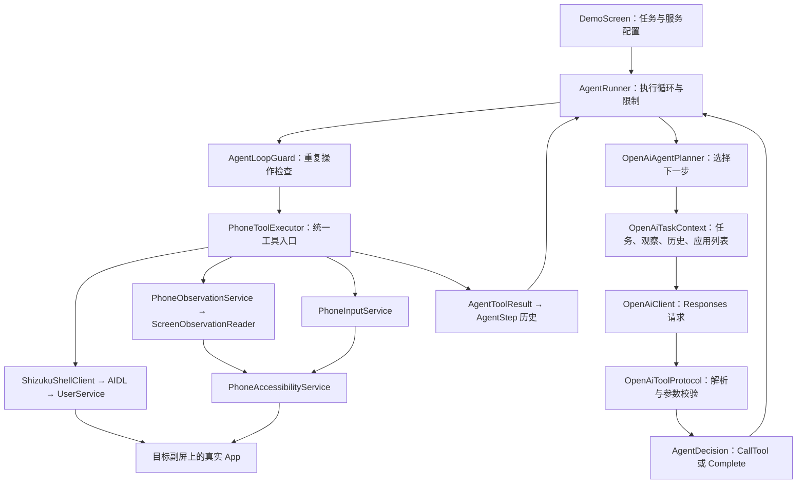

# MaoPhoneAgent

一个探索“用户使用主屏、Agent 同时在副屏操作真实 App”的 Android Agent 原型。

用户用自然语言描述任务，Agent 读取目标屏幕的 UI 和截图，逐轮决定并执行操作。项目选择同一台设备上的第二块显示屏作为执行空间，目标是让任务真实作用于设备中安装的 App 和账号，同时尽量隔离用户的前台操作。

**当前阶段：已实现指定scrcpy生成的副屏上的 Agent 执行闭环。**


## 当前能力与要求

| 要求 | 当前实现 | 验证边界 |
| --- | --- | --- |
| 自然语言与实时决策 | OpenAI 根据当前观察和执行历史选择下一步工具 | 固定脚本只用于底层测试，Demo 使用 AI Planner |
| 操作真实第三方 App | 指定副屏启动 App、点击、滑动、输入文字、提交、返回和 Home | 兼容性取决于系统和目标 App，不能保证所有 App 都可在副屏运行 |
| 用户与 Agent 同时使用设备 | AgentSession 固定为大于 0 的显示屏 ID，执行器检查屏幕是否存在 | 已有屏幕寻址约束；主屏持续操作时的焦点、IME 和性能隔离仍需专项验收 |
| 结果可验证 | 动作后重新观察；简单打开应用任务有本地完成判断 | 多步任务仍由模型根据观察判断完成，尚无通用业务结果验证器 |
| 用户主动交接 | 暂未实现专门的交接状态、通知和恢复流程 | 当前不应把支付、登录、验证码流程作为已支持能力 |
| 实际执行画面 | 可用外部虚拟屏投屏工具展示 Agent 屏幕 | App 内的进度文字不能替代实际画面；本项目暂不创建或管理虚拟屏 |

开发过程中已测试指定副屏打开 Settings、打开 Bilibili，以及在 Bilibili 中输入关键词并搜索。搜索任务曾出现重复提交，现已加入进度提示和循环保护

## 技术方案与选择理由

### 同一设备上的副屏，而非操作用户主屏

主屏为用户保留，Agent 使用外部工具创建的第二块显示屏。App 启动和输入事件带上明确的 display ID；观察和文字输入也限定目标显示屏。

### Shizuku 执行动作，Accessibility 读取界面和操作输入框

| 技术 | 当前职责 | 选择理由 |
| --- | --- | --- |
| Kotlin、Jetpack Compose | Android 应用、Demo 和工具测试界面 | 方便直接接入 Android 服务和观察执行状态 |
| Shizuku UserService + AIDL | 执行指定屏幕的 Shell 动作和应用启动 | 将需要 Shell 能力的操作集中到独立服务，并沿用 ADB 可验证的命令 |
| Accessibility | UI 树、截图、输入框文字设置与提交 | 同时提供界面语义与图像；文字设置支持中文和空格 |
| OpenAI Responses + function calling | 将任务与观察转换成工具选择 | 工具参数可校验；模型负责决策，应用负责执行与约束 |
| 协程与 Mutex | 异步执行、串行工具调用、取消和超时 | 避免同一执行器内操作交错，并限制单次任务运行范围 |

当前方案不要求项目获得 Root、系统签名或修改 ROM；演示依赖开发者权限、Shizuku、无障碍服务和外部副屏工具。是否能在某一普通用户手机上完整工作，需要逐设备验证。

## 架构



一次任务的执行流程：

1. 用户选择实际存在的副屏 ID，并输入自然语言任务。
2. 首次 AI 请求前，先执行 `observe` 和 `list_apps`，将当前屏幕和完整应用包名列表一并提供给模型。
3. 模型选择一个工具；协议层解析参数，执行器检查屏幕和参数，然后执行。
4. AI Planner 在动作后等待 750 毫秒，并强制重新观察。工具成功只代表操作接受或命令完成，不代表任务目标达成。
5. 模型根据新观察和历史继续决策，或者调用 `complete`。
6. Runner 记录结果、显示进度，并在超时、达到调用上限或检测到无效重复时停止。

模型每轮选择下一步，不预先生成固定点击序列。显示屏由应用选择，模型不能在工具参数中改变它。

## 工具接口

| 工具 | 参数 | 执行方式 |
| --- | --- | --- |
| `observe` | 无 | 读取目标屏幕 UI JSON 和 PNG 截图 |
| `tap` | `x`, `y` | Shizuku，指定屏幕点击 |
| `swipe` | 起止坐标、`durationMs` | Shizuku，指定屏幕滑动 |
| `input_text` | `text` | Accessibility，替换目标屏幕已聚焦输入框的全部文字 |
| `submit_input` | 无 | Accessibility，触发输入框配置的 IME 操作 |
| `home` / `back` | 无 | Shizuku，指定屏幕按键 |
| `launch_app` | `packageName` | Shizuku，指定屏幕启动应用 |
| `list_apps` | 无 | Shizuku，读取设备安装包名列表 |
| `complete` | `message` | 结束决策，不执行手机动作 |

`input_text` 最多接收 2000 字符，空字符串用于清空。执行前需要目标屏幕上恰好存在一个可见、启用、已聚焦且可编辑的输入框。如果不支持 `submit_input`，模型可以观察后点击可见的提交按钮。

应用列表包含没有启动界面的包，不等于可启动 App 列表。目前提供 Settings 和 Bilibili 的名称 aliases；Bilibili 还配置了当前测试版本验证过的入口 `tv.danmaku.bili/.MainActivityV2`。这是服务层的兼容性配置，App 更新后可能需要调整，不能视为通用入口解析。

### 完成与循环保护

- 单纯“打开应用”的任务：`OpenAppCompletion` 对明确匹配的任务检查新 UI 中目标包是否拥有可见的 active/focused 应用窗口。
- 多步任务：模型必须依据当前观察确认用户要求的全部结果；目前仍可能误判，需要人工复核演示结果。
- `AgentLoopGuard`：忽略采集时间，比较可读 UI；同一界面上连续执行两次相同操作却无变化时，Runner 阻止第三次并返回未完成。
- 循环保护不覆盖重复 Swipe、截图单独可用的观察、坐标变化或界面持续变化的循环；这些由总调用次数和超时兜底。
- Demo 当前限制为 20 次工具调用、180 秒。初始化与观察也占用次数。“停止”会取消后续执行，不撤销已经发生的操作。

## 代码导航

```text
app/src/main/
├── AndroidManifest.xml
├── aidl/com/example/maophoneagent/IShellUserService.aidl
├── java/com/example/maophoneagent/
│   ├── MainActivity.kt
│   ├── agent/
│   │   ├── ai/          # OpenAI 请求、协议、上下文、简单完成判断
│   │   ├── model/       # Session、Decision、ToolCall、Result、Step
│   │   ├── planner/     # AI Planner 与测试用 Scripted Planner
│   │   ├── runtime/     # Runner 与 LoopGuard
│   │   └── tool/        # PhoneToolExecutor
│   ├── application/service/
│   │                   # PhoneActionService、PhoneObservationService、PhoneInputService
│   ├── domain/controller/
│   │                   # 早期控制器抽象
│   ├── infrastructure/
│   │   ├── accessibility/ # 无障碍服务、UI 读取和截图
│   │   ├── controller/    # 无障碍控制器与 Mock 实现
│   │   └── shizuku/       # 授权、Shell Client、UserService
│   └── ui/
│       ├── screen/     # DemoScreen、TestScreen 和各项测试 UI
│       ├── theme/
│       └── viewmodel/
└── res/xml/accessibility_service_config.xml
```

理解 Agent 主链路可按 `AgentToolCall → PhoneToolExecutor → AgentDecision → AgentRunner → OpenAiAgentPlanner` 阅读。早期 `PhoneController / PhoneActionService` 主要服务于控制器测试；实际 AI 工具走 `PhoneToolExecutor`。

## 构建与运行

### 环境

- Android Studio，以及能够同步当前 Gradle/AGP 配置的环境。
- Android SDK：当前 `compileSdk / targetSdk` 为 37，`minSdk` 为 30（Android 11）。
- Gradle Wrapper 为 9.6.0，AGP 为 9.4.1；具体版本见仓库配置。
- `gradle/gradle-daemon-jvm.properties` 当前指定 Gradle Daemon 使用 JDK 25；源码 Java 兼容级别为 11。构建机需提供对应 JDK，或允许 Gradle 下载配置的工具链。
- ADB、Shizuku，以及能创建并投屏副屏的外部工具，例如支持 `--new-display` 的 scrcpy。
- 目标设备已安装待操作 App；需要账号的任务应提前登录。可访问网络，并准备具有所选模型访问权限的 OpenAI API Key。

Windows PowerShell：

```powershell
.\gradlew.bat :app:assembleDebug
adb install -r app/build/outputs/apk/debug/app-debug.apk
```

macOS / Linux：

```bash
./gradlew :app:assembleDebug
adb install -r app/build/outputs/apk/debug/app-debug.apk
```

首次构建可能需要下载工具链和依赖；仅在缓存完整时使用 `--offline`。本项目当前直接 API 配置入口只在 Debug 构建启用。

### 准备服务与副屏

1. 开启设备开发者选项和调试，确认 `adb devices` 显示设备已连接。
2. 安装并启动 Shizuku，按其[官方用户手册](https://shizuku.rikka.app/guide/setup/)完成无线调试或电脑启动。通过非 Root 方式启动后，设备重启通常需要重新启动服务。
3. 用外部工具创建副屏并保持其运行。例如：

   ```bash
   scrcpy --new-display=720x1280 --display-ime-policy=local
   ```

   这里参考的是 [scrcpy v3.3.3 的虚拟屏文档](https://github.com/Genymobile/scrcpy/blob/v3.3.3/doc/virtual_display.md)。该版本默认会把副屏 IME 放在默认屏幕，`local` 用于让它出现在副屏；使用前确认本机 `scrcpy --help` 支持此参数。该设置仍不能替代主屏焦点、键盘并发测试。

4. 查询实际屏幕 ID：

   ```bash
   adb shell dumpsys display
   ```

   主屏 ID 为 0；Agent 只接受大于 0 且存在的屏幕。副屏 ID 不固定，Demo 的默认值 1 只是输入初值。如果实际为 2，就填写 2。

5. 打开 MaoPhoneAgent，点击“打开设置”，启用 `MaoPhoneAgent Control` 无障碍服务。
6. 返回 Demo，点击 Shizuku“连接 / 授权”，批准请求，再连接 UserService，确认无障碍和 UserService 均显示已连接。
7. 在“AI 设置”中输入 API Key 和模型 ID。当前默认字符串为 `gpt-5.6-luna`，可改为账号实际可用且支持当前图像与工具调用方式的模型。

本项目暂不创建副屏；关闭外部虚拟屏工具可能导致副屏及其活动被销毁，执行器会在下一次请求时检查屏幕是否仍存在。

### 运行任务

填写目标屏幕 ID，在 Demo 输入任务，例如：

```text
打开设置
打开 Bilibili，搜索猫咪视频，显示搜索结果后停止。
Open Bilibili and search for cat videos.
```

点击“运行任务”，同时观察副屏实时画面。Demo 展示每一步调用与结果；“测试”入口提供观察、动作、输入、Runner 和 AI 决策等独立测试，方便区分底层执行问题与模型决策问题。

## 数据与权限边界

API Key 仅保存在当前页面内存中，不写入仓库或配置文件。任务、应用包名列表、UI 内容、最新截图和执行历史会发送给 OpenAI；截图与 UI JSON 也会临时保存在应用私有缓存。请求使用 `store=false`，但这不等于不发生远程传输。

UI 树导出会省略密码控件的文字；截图仍可能包含其他敏感信息，安全窗口也可能无法截图。演示应使用获授权的设备、账号和可展示的数据。

## AI 辅助开发

本项目开发过程中使用 Coding Agent 辅助实现工具、注释、执行循环、OpenAI 接入和文档。开发者负责选择副屏路线、定义工具边界、审查改动，并通过 ADB 与实际 App 测试验证结果。
